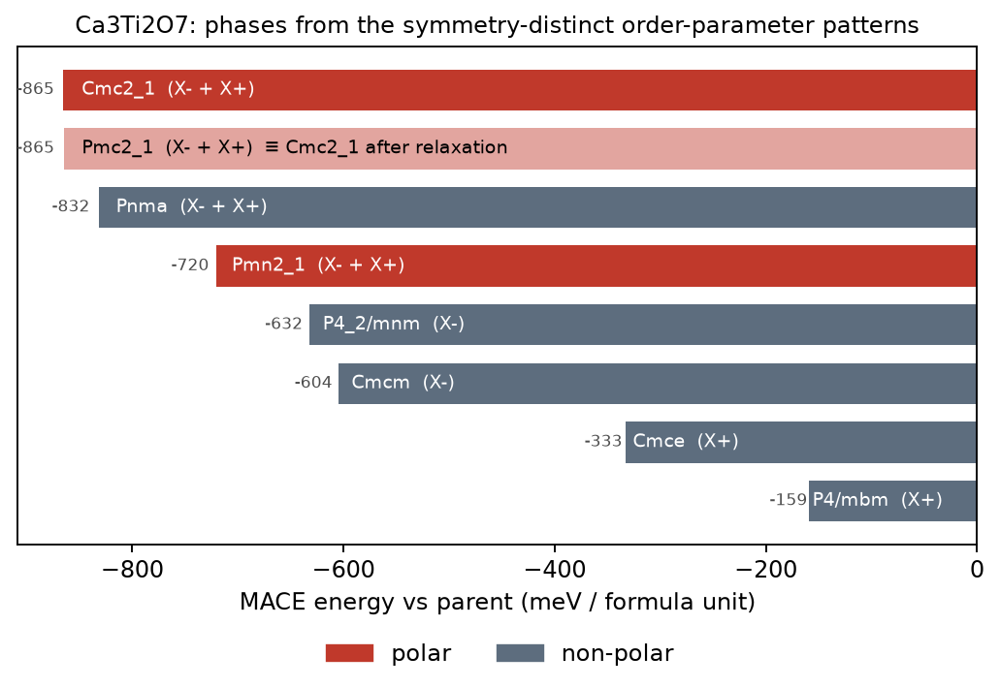

# LandauAgent

**From a high-symmetry crystal to its Landau free energy, its instabilities and its low-symmetry phase, with an LLM that plans and explains but never does the group theory.**

Built for the Open Scientific Intelligence (OSI) Hackathon, 21–22 October 2026.

## The problem

Explaining a structural phase transition means answering three questions:
- Which modes condense?
- Which couplings does symmetry allow?
- Is the transition continuous?

The standard route is Landau theory, which in practice is expert hand-work with group-theory tables (ISOTROPY/ISODISTORT, Bilbao) followed by expensive DFT to put numbers on the coefficients.

Language models alone are unreliable at exactly this algebra. Universal machine-learned interatomic potentials (MLIPs), on the other hand, now make frozen-mode energy surfaces nearly free. LandauAgent joins the two: every number is computed, and the language model chooses what to compute and explains what it means.

## What it does

Given a parent structure, LandauAgent:

1. **Builds the parent space group on a supercell** and splits the 3N displacement space into physically irreducible representations. This is numerical but exact: commutant diagonalisation, characters, k-stars from translation eigenphases, and inversion parity.
2. **Finds instabilities.** It computes MACE-MP-0 force constants, symmetrises them exactly, projects them onto every irrep block, and flags negative curvature as an instability.
3. **Finds forced secondary modes.** A mode that appears *linearly* in an invariant with the primary order parameters must condense with them, whether or not it is unstable on its own. This is how improper and hybrid-improper ferroelectricity is diagnosed.
4. **Generates the Landau polynomial.** It applies the Reynolds operator to all monomials and row-reduces in rational arithmetic, and checks the Landau condition (no cubic invariant). The representation matrices are computed numerically and rationalised; in the cleaned order-parameter bases their entries are exactly 0 and ±1, so the invariants are exact.
5. **Fits the coefficients** to MACE frozen-mode energies (meV per formula unit).
6. **Predicts the ground state, by direct enumeration.** It enumerates every symmetry-distinct order-parameter direction pattern, screens them with one MACE energy each, relaxes the best inside their own symmetry (fixed and relaxed lattice), and ranks them by energy.
7. **Explains it with the Landau model.** The fitted polynomial says *why* the winner wins: which couplings lower its energy and which mode is driven by which. The polynomial's own minimum is also relaxed with MACE as a cross-check, but for deep, anharmonic wells it is a worse predictor than the enumeration, so we use it for the mechanism, not the verdict.

It can also take an *observed* low-symmetry structure and decompose it into irreps (`analyze_child`).

## Results

| Material | Parent | Found instabilities | Forced coupling | Predicted phase | Literature |
|---|---|---|---|---|---|
| SrTiO₃ | Pm-3m | R⁺ and M⁺ tilts; a polar Γ⁻ mode **only at the MACE (PBE-like) volume** | — | at the MACE lattice: spurious polar Cc (−5.1 meV/f.u.); at the experimental lattice the polar instability vanishes and the three tilt systems are within 0.25 meV/f.u. of each other (not resolvable) | I4/mcm below 105 K, paraelectric to 0 K; semilocal DFT overestimates the tilt (PBEsol 5.7°) |
| Ca₃Ti₂O₇ | I4/mmm | X⁻ tilt and X⁺ rotation (O-dominated); also a weaker polar Γ⁻ instability in MACE | polar Γ⁻ via the trilinear invariant X⁻·X⁺·P | **Cmc2₁ = A2₁am**: −865.1 meV/f.u. (fixed lattice), −882.4 (relaxed lattice); X⁻ 1.75 Å, X⁺ 1.22 Å, Γ⁻ 0.85 Å; P ≈ 15 μC/cm² (nominal charges, fixed lattice) | A2₁am via X2⁺ ⊕ X3⁻ ⊕ Γ5⁻, P ≈ 20 μC/cm² (Benedek & Fennie 2011) |

### Ca₃Ti₂O₇ in detail: hybrid improper ferroelectricity from the parent alone

The only input is the I4/mmm parent (`results/Ca3Ti2O7_run.txt`, `Ca3Ti2O7_log.json`).

1. **Instabilities.** The strongest MACE instabilities are X-point octahedral modes: an X⁻ tilt (−1.65 eV/Ų, O with some Ca) and an X⁺ rotation (−1.30 eV/Ų, O only). The scripted run takes the softest mode of each type. A second, pure-O X⁻ mode (−1.37) is not included; the agent can choose it.
2. **Coupling.** The engine finds a polar Γ⁻ mode that appears **linearly** in one trilinear invariant with them:
   `X⁻₁·X⁺₁·(P₁ − P₂) + X⁻₂·X⁺₂·(P₁ + P₂)`
   Each k-arm's tilt × rotation product drives one in-plane polarisation direction. This is the coupling behind hybrid improper ferroelectricity. *Caveat and volume test:* at the MACE lattice the polar mode is weakly unstable on its own (−0.48 eV/Ų). Contracting the parent by 1.2% in a and 0.3% in c (`results/Ca3Ti2O7_exp_instabilities.json`, about the size of MACE's PBE-like overestimate) makes it essentially neutral (−0.006 eV/Ų), while the tilt (−1.77) and rotation (−1.52) strengthen. As in SrTiO₃, the polar instability is mostly a volume artefact of the potential; at the smaller volume the polarisation must come from the trilinear coupling.

   **Direct test of the hybrid-improper mechanism** (`results/Ca3Ti2O7_contracted_enumeration.json`). At this contracted lattice we enumerate phases with **only the X⁻ tilt and X⁺ rotation** as order parameters. The polar mode is not an order parameter, but every relaxation lets it develop if symmetry allows (fixed lattice, meV/f.u. vs I4/mmm):

   | Phase | Tilt / rotation pattern | Energy | Nominal P (μC/cm²) |
   |---|---|---|---|
   | **A2₁am (Cmc2₁)** | same k-arm | **−933.2** | **9.5** |
   | Pnma | different k-arms | −891.8 | 0 |
   | P4₂/mnm, Cmcm (tilt only) | | −655.3, −640.9 | 0 |
   | Cmce (rotation only) | | −427.8 | 0 |

   The polar mode has essentially no drive of its own here (−0.006 eV/Ų), yet the ground state carries 9.5 μC/cm². When tilt and rotation sit on different arms the trilinear term vanishes; that phase (Pnma) is non-polar and loses by 41 meV/f.u. This is the textbook hybrid-improper mechanism, reproduced end to end.
3. **Landau prediction.** The fitted model has 6th order in each mode and couplings to 4th. Its RMSE is 14 meV/f.u. over sampled configurations below the parent (lowest −540 meV/f.u.). Its minimum is a Pmn2₁ point at −633 meV/f.u. (MACE gives −590 there). Relaxing that structure with MACE gives −865.16 meV/f.u.: Pmn2₁ at 0.001 Å tolerance, **Cmc2₁ (A2₁am) at 0.01 Å**, with residual second-arm tilt 0.009 Å (`Ca3Ti2O7_decompositions.json`). So the fitted polynomial gets into the right basin but does not pin the exact minimum; the deep, strongly anharmonic coupled wells need the MACE relaxation.
4. **Independent check: direct enumeration.** Every symmetry-distinct tilt/rotation pattern is relaxed with MACE inside its own symmetry (meV/f.u. vs I4/mmm; † = loose relaxation only):

| Phase | Fixed lattice | Relaxed lattice | Nominal P, fixed lattice (μC/cm²) |
|---|---|---|---|
| Cmc2₁ (A2₁am) | −865.1 | −882.4 | 14.6 |
| Pmc2₁* | −865.0 | −882.4 | 14.2 |
| Pnma | −831.9 | −842.1 | 0 |
| Pmn2₁ † | −720.1 | | 1.1 |
| P4₂/mnm (tilt only) † | −632.2 | | 0 |
| Cmcm (tilt only) † | −604.4 | | 0 |
| Cmce (rotation only) † | −332.6 | | 0 |
| P4/mbm (rotation only) † | −159.1 | | 0 |

\*The relaxed Pmc2₁ structure has the same mode amplitudes as A2₁am (X⁻ 1.74, X⁺ 1.22, Γ⁻ 0.85 Å). Only 0.0005 Å of second-arm rotation and 0.04 Å of a Z⁻ mode remain (`Ca3Ti2O7_decompositions.json`). It is A2₁am held at a lower imposed symmetry, not a separate phase.

At fixed lattice, the polar phase is more than 230 meV/f.u. below any tilt-only or rotation-only phase.



### SrTiO₃: catching a known failure of the potential

At its own relaxed lattice (a = 3.943 Å, about 1% larger than experiment, as expected for a PBE-trained model), MACE-MP-0 finds three instabilities in cubic SrTiO₃: a polar Γ⁻ mode (−0.64 eV/Ų), the R⁺ octahedral tilt (−0.28) and a weak M⁺ tilt (−0.04). Enumeration then gives a polar ground state (Cc, close to R3c, −5.1 meV/f.u.) just below the experimental tetragonal phase I4/mcm (−3.5 meV/f.u.).

Real SrTiO₃ is not ferroelectric, so this prediction is wrong. LandauAgent can test why. Recomputing the instabilities at the **experimental** lattice constant (3.905 Å):

| Mode | Curvature at MACE lattice (eV/Ų) | Curvature at experimental lattice (eV/Ų) |
|---|---|---|
| Γ⁻ polar | −0.64 | **0.00** (only the acoustic translation remains) |
| R⁺ tilt (O only) | −0.28 | −0.42 |
| M⁺ tilt (O only) | −0.04 | −0.15 |

The ferroelectric instability is a volume artefact of the potential, while the tilts are robust. At the experimental lattice the tilt-only enumeration gives (meV/f.u. vs cubic):

| Tilt system | Fixed cubic lattice | Relaxed lattice |
|---|---|---|
| **I4/mcm (a⁰a⁰c⁻)** | −6.95 | **−32.03** |
| Imma (a⁰b⁻b⁻) | −6.99 | −31.77 |
| R-3c (a⁻a⁻a⁻) | −6.76 | −31.62 |

At the fixed experimental lattice the three tilt systems lie within 0.25 meV/f.u. of each other, below what we would trust MACE to resolve. In the "relaxed lattice" column the cell is free, so it expands back towards the MACE volume (a ≈ 3.93–3.95 Å). Most of the extra ~25 meV/f.u. is that volume relaxation, not tilt–strain coupling. I4/mcm comes out lowest there (Pmmn relaxes to the same energy), but the margins are a few tenths of a meV/f.u. **The honest conclusion: MACE reproduces the tilt instability and its R4⁺ symmetry, but cannot decide between the tilt systems of SrTiO₃.**

The R⁺ invariants the engine derives (η², Σηᵢ⁴, Σηᵢ²ηⱼ², no cubic term) are the textbook R4⁺ expansion. In the Landau fit at the MACE lattice (`results/SrTiO3_log.json`), the cross-quartic coefficient (48.28 meV/f.u. per Å⁴) is only marginally larger than twice the single quartic (2 × 23.65), which at quartic order is the condition that favours a single-axis tilt. The fit also has small 6th-order terms. This marginality is the same near-degeneracy seen in the enumeration.

## Benchmark: seven materials with known ground states

The same automated protocol on every material (`run_benchmark.py`): the MACE-relaxed parent, up to three distinct unstable irreps as primaries, symmetry-complete enumeration, then the four lowest candidates re-relaxed with a free cell (fmax 0.01 eV/Å). The winner is the lowest relaxed-cell energy. Space groups are reported at the strict tolerance and at 0.01 Å. **No volume correction is applied here**, so this is what the potential gives without the agent's volume check.

v1 is our first protocol. Its misses exposed two bugs in the pipeline, both fixed in v2: the enumeration directions were not symmetry-complete (Pnma could never be generated), and candidates were picked for refinement by fixed-lattice energy (strain-favoured phases such as P4mm were never refined). v1 results are kept in `results/benchmark_*.json`, v2 in `results/benchmark_v2_*.json`.

| Material | Known ground state | v1 winner | v2 winner (strict / 0.01 Å) | v2 energy (meV/f.u.) | v2 verdict |
|---|---|---|---|---|---|
| Ca₃Ti₂O₇ | A2₁am (Cmc2₁) | Cmc2₁ | Cm / **Cmc2₁** | −882.3 | **hit** |
| Sr₃Zr₂O₇ | A2₁am (Cmc2₁) | Cmc2₁ | Pm / **Cmc2₁** | −807.5 | **hit** |
| PbTiO₃ | P4mm | Amm2 | P4bm / **P4mm** | −189.7 | **hit** (v1 miss) |
| LaAlO₃ | R-3c | Imma | Imma | −27.21 (R-3c −26.92) | near miss, 0.3 meV/f.u. |
| BaTiO₃ | R3m | Pc | Aem2 | −40.47 (I4cm −40.36, P4bm −40.14) | miss |
| CaTiO₃ | Pnma | Ima2 | R3c | −274.4 (Imma −262.2, R-3c −246.7) | miss |
| SrTiO₃ | I4/mcm | Cc | R3c | −5.19 | miss (fixed by volume check, see above) |

**3 hits and 1 near miss out of 7**, up from 2 in v1. In the two strict-tolerance labels (Cm, Pm) the residual distortion beyond Cmc2₁ is below 0.01 Å.

What the misses say:
- **CaTiO₃ and SrTiO₃ are polar artefacts of the PBE-like volume.** At the MACE lattice both have a strong polar Γ⁻ instability (−1.35 and −0.64 eV/Ų), and the polar phase wins. For SrTiO₃ we showed that the instability disappears at the experimental lattice. This is exactly the failure the agent's `rescale_parent` check is there to catch; the benchmark deliberately runs without it.
- **BaTiO₃** has three nearly degenerate polar or antipolar instabilities in MACE (Γ⁻ −4.83, X⁻ −4.48, M⁻ −4.41 eV/Ų), and the top three phases lie within 0.3 meV/f.u. The potential gives no usable ranking.
- **LaAlO₃** has the right instability (R⁺ dominates), and R-3c is among the four refined candidates, but Imma is 0.3 meV/f.u. lower. Like the SrTiO₃ tilt systems, this is below MACE's resolution.

The pattern is useful in its own right: where the physics is driven by large, strongly coupled oxygen-octahedron modes (the layered hybrid-improper compounds, PbTiO₃'s large polar distortion), the pipeline gets the ground state. Where the answer depends on sub-meV differences or on the equilibrium volume, it fails, and the tool output (near-degenerate energies, a polar mode that is volume-sensitive) shows that it is in that regime.

## How the LLM is used, and how it isn't

The agent (`landau_agent/agent.py`) is a tool-calling loop. The model picks the supercell, decides which instabilities to treat as order parameters, adds forced secondary modes, and writes the physical interpretation.

The system prompt forbids it from deriving irreps, invariants, couplings, energies or space groups itself. Those come only from tools. Irrep names are computed (k-point, inversion parity, dimension, polarity, which atoms move). The model may state a textbook correspondence only when that output makes it unambiguous.

## Computed labels vs standard (ISOTROPY/Bilbao) labels

LandauAgent labels irreps by what it computes: k-point, inversion parity (about the parent origin), dimension and an index, plus polarity and which atoms move. The standard names below are a **hand-made correspondence**, made from those computed properties and the displacement pattern. They are not computed by the code.

| Parent (origin) | Computed label | Pattern | Standard label |
|---|---|---|---|
| Pm-3m (B site at origin) | Γ⁻ (d=3), polar | B against O, polar | Γ4⁻ |
| | R⁺ (d=3), O only | out-of-phase octahedral rotation | R4⁺ |
| | M⁺ (d=3), O only | in-phase octahedral rotation | M3⁺ |
| I4/mmm (n=2 Ruddlesden–Popper) | X⁺ (d=2) `#4`, O only | in-phase rotation about c | X2⁺ |
| | X⁻ (d=2) `#2`, O plus A site | octahedral tilt about an in-plane axis | X3⁻ |
| | Γ⁻ (d=2) `#1`, polar | in-plane polar mode | Γ5⁻ |

Other irreps with the same short name (for example the second, pure-O X⁻ instability in Ca₃Ti₂O₇, `#8`) are distinct representations. The index in the label separates them; we have not mapped them to standard names.

## Provenance of the results

All numbers above come from the **scripted pipeline** (`run_case.py`, `run_enumerate.py`, `run_sto_tilts.py`, `run_decompose.py`, `run_benchmark.py`), which calls exactly the same tools the agent uses, in the order the agent's system prompt describes. The LLM agent itself was not run for these results: no API key was available in the build environment. The tool layer is tested against the agent's tool schema (`tests/test_agent_tools.py`). Raw outputs, logs and structures are in `results/`.

## Install and run

```bash
python -m venv .venv && . .venv/bin/activate
pip install torch mace-torch ase pymatgen spglib sympy scipy anthropic
python run_case.py SrTiO3            # scripted pipeline, no LLM needed
python run_case.py Ca3Ti2O7
export ANTHROPIC_API_KEY=...         # agent mode
python -m landau_agent.agent "Why is Ca3Ti2O7 ferroelectric? Start from the I4/mmm parent."
```

A GPU is optional. On two CPU cores each scripted case takes about 5–10 minutes, and the phase enumeration with tight refinement 10–40 minutes. Force constants are cached in `results/`.

## Limitations

- 0 K frozen-mode energies; no temperature, so no transition temperatures (yet).
- The Landau fit uses the fixed parent lattice: strain coupling is not in the polynomial. Strain enters only through the final MACE cell relaxations, which also move towards the MACE equilibrium volume.
- MACE-MP-0 is PBE-trained, so energy scales inherit PBE errors (e.g. overestimated tilts).
- Only k-points commensurate with the chosen supercell are visible.
- Polarisation uses nominal ionic charges, not Born effective charges, so it is an estimate.
- Irrep labels are computed descriptors (k-point, parity, dimension), not ISOTROPY's numbered labels.

## References

- N. A. Benedek and C. J. Fennie, *Hybrid improper ferroelectricity*, Phys. Rev. Lett. 106, 107204 (2011). [arXiv:1007.1003](https://arxiv.org/abs/1007.1003)
- I. Batatia et al., MACE-MP-0 foundation model (2023).
- H. T. Stokes, D. M. Hatch, H. M. Nelson, *Landau, Lifshitz, and weak Lifshitz conditions*, Phys. Rev. B 47, 9080 (1993).
- C. Capillas et al., *SYMMODES*, J. Appl. Cryst. 36, 953 (2003).
